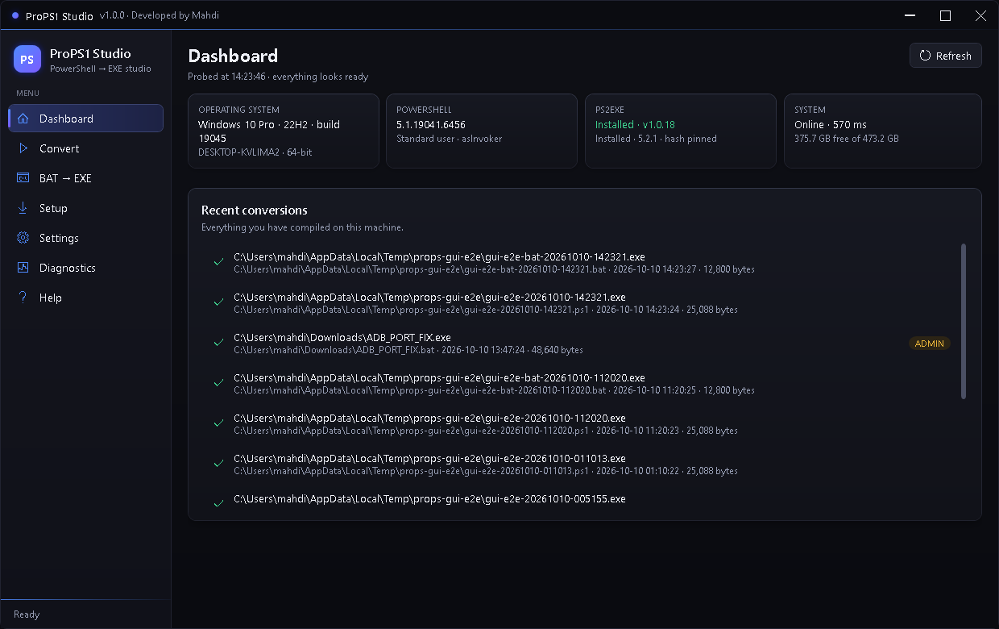

# ProPS1 Studio

**Developed by Codna Mahdi.**

Production-quality Windows desktop app that compiles PowerShell scripts (`.ps1`) into standalone
Windows executables (`.exe`) using the open-source [ps2exe](https://github.com/MScholtes/PS2EXE)
module — with optional UPX compression, UAC manifest embedding (run-as-administrator), script
source encryption, secret scanning, Authenticode signing, dependency management, diagnostics
and tests.



## Features

- **Convert** — one-click `.ps1` → `.exe`: console or windowed output, run-as-administrator UAC
  manifest, embedded version resources (title/company/product/version/copyright/description) and
  custom `.ico`, overwrite control, live compiler output, cancellable builds.
- **UPX compression** — official UPX 5.2.1, downloaded from the GitHub release and verified
  against a pinned SHA-256 hash; automatically skipped (with a warning) for .NET assemblies,
  which UPX cannot compress.
- **Secret scanning** — built-in rule set plus custom regex patterns; findings are masked in the
  UI, logs and diagnostics bundles; critical findings block the build.
- **Script source encryption** — optional AES-256-CBC: the script is baked into the exe as
  ciphertext, so opening the exe in Notepad no longer shows the source. The decryption key lives
  inside the executable — this hides the script from casual inspection, not full copy protection.
- **Output protection** — on by default: the finished exe is wrapped in a per-build AES-256
  encrypted stub that decrypts it at launch and refuses to run under a debugger
  (`Debugger.IsAttached` / `IsDebuggerPresent`). Forces decompilation or a
  memory dump to inspect — obfuscation, not DRM: the key ships inside the exe. The stub
  deliberately avoids process-name scanning and XOR-string obfuscation (patterns that trip
  Defender heuristics such as the XWorm false positives).
- **Authenticode signing** — certificate by thumbprint/store or PFX file, optional RFC 3161
  timestamp, automatic sign-after-convert. The PFX password is read only from the
  `PROPS_SIGN_PFX_PASSWORD` environment variable and never stored.
- **Setup page** — real-time status of ps2exe (installed version + detected parameter count)
  and UPX (hash verification), with one-click install for missing tools.
- **Dashboard** — environment health cards and a history of recent conversions.
- **Diagnostics** — live log stream, environment report, and a redacted support-bundle export.
- **Settings** — persisted `settings.json` with defaults for output folder, conversion timeout,
  log level, tool paths, extra secret patterns and signing.

Your script is never executed by the app — only compiled.

## Requirements

- Windows 10 (1809+) or Windows 11, x64
- PowerShell 5.1+ (included with Windows)
- No .NET runtime install needed — the release build is self-contained
- ps2exe and UPX are installed by the app (Setup page); ps2exe comes from the PowerShell Gallery

## Installing

Release artifacts (in `publish\`):

| Artifact | Description |
|----------|-------------|
| `ProPS1Studio-Setup-1.0.0-x64.exe` | Inno Setup installer (per-user, Start menu + desktop shortcuts) |
| `ProPS1Studio-portable-1.0.0-x64.zip` | Portable build — unzip anywhere and run `ProPS1Studio.exe` |

Both are self-contained; all per-user data lives in `%LOCALAPPDATA%\ProPS1Studio`.

## Building from source

```powershell
# .NET 8 SDK required (https://dotnet.microsoft.com/download)
# -m:1 keeps the WPF markup-compile step single-threaded (parallel builds can race on wpftmp)
dotnet build ProPS1Studio.sln -m:1 -v q --nologo
dotnet test  ProPS1Studio.sln -m:1 -v q --nologo

# Release publish (self-contained win-x64)
dotnet publish src\ProPS1Studio.App\ProPS1Studio.App.csproj `
    -c Release -r win-x64 --self-contained true -o publish\app
```

Packaging (run after publish):

```powershell
.\build\Package-Release.ps1          # portable zip + installer
```

## Project layout

```
ProPS1Studio.sln
src/
  ProPS1Studio.Core/      # conversion engine, secret scanner, UPX, signing,
                          # environment probe, diagnostics, logging (net8.0-windows)
  ProPS1Studio.App/       # WPF app: MVVM, views, themes, self-test capture
tests/
  ProPS1Studio.Core.Tests/          # 98 unit tests
  ProPS1Studio.Integration.Tests/   # 18 end-to-end tests (real ps2exe/UPX/signing)
build/                    # icon generator, packaging script
docs/                     # user-guide.md, licenses/
tools/                    # screenshot/launch helpers (dev only)
```

## Documentation

- [User guide](docs/user-guide.md) — full feature reference and troubleshooting
- [Third-party licenses](docs/licenses/THIRD-PARTY-NOTICES.md) — ps2exe (MS-PL 1.1), UPX (GPLv2+), .NET (MIT)

## License

See `docs/licenses/` for third-party license texts. Project license: add your preferred
`LICENSE` file before publishing.
